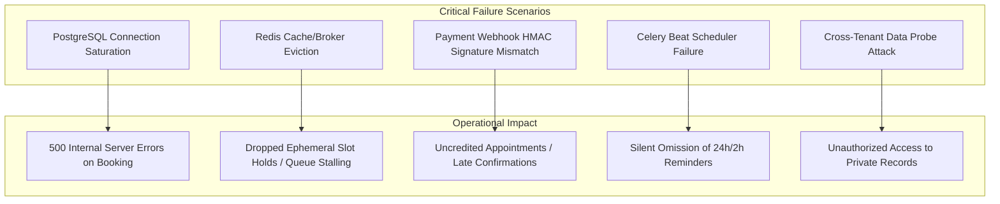
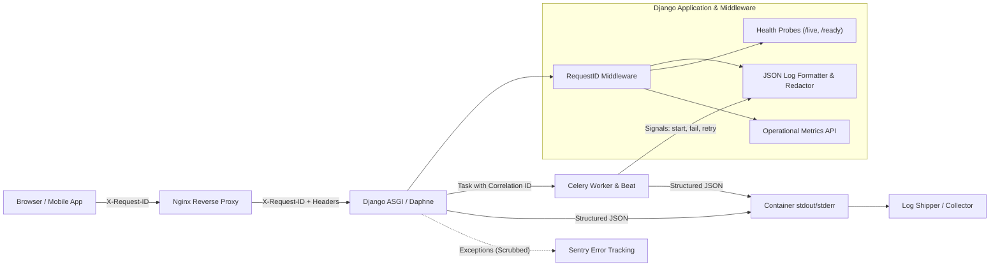

# EazyDoc — Monitoring, Logging & Operational Assessment

**Document Version:** 1.0.0  
**Target Architecture:** Multi-Tenant Doctor Booking & Clinic Management SaaS  
**Author:** DevOps & Site Reliability Engineering Team  
**Evaluation Date:** 04 November 2026  
**Status:** **`APPROVED FOR IMPLEMENTATION`**

---

## 1. Executive Summary

EazyDoc has reached staging release readiness with hardened multi-tenant Django, React, PostgreSQL 16, Redis 7, Celery, and Nginx container topologies. As the platform prepares for continuous staging operations and production rollout, visibility into application health, performance bottlenecks, backing service failures, and security events is critical.

This assessment examines the existing monitoring, logging, and observability posture across all infrastructure tiers, identifies operational risks, and lays out the target monitoring architecture for Day 17.

---

## 2. Existing Monitoring Capabilities

| Tier | Component | Current Implementation | Assessment |
| :--- | :--- | :--- | :--- |
| **API Health** | `GET /api/v1/health/` | Executes `SELECT 1;` on PostgreSQL and `ping()` on Redis. Returns HTTP 200 or 503. | Basic monolithic check; lacks separate liveness vs readiness separation for Kubernetes/Docker orchestrators. |
| **Logging** | Python `logging` (`base.py`) | StreamHandler to console with `[{asctime}] [{levelname}] [{name}:{lineno}] {message}` format. | Unstructured plain text; lacks request correlation IDs, JSON formatting, and automated sensitive data redaction. |
| **Error Tracking** | Sentry SDK (`staging.py`, `production.py`) | Configured with `DjangoIntegration`, `CeleryIntegration`, and `RedisIntegration` when `SENTRY_DSN` is set (`send_default_pii=False`). | Functional when DSN is provided; requires local logging fallback and frontend error boundary integration when DSN is absent. |
| **Containers** | Docker Healthchecks | DB uses `pg_isready`; Redis uses `redis-cli ping`; Backend uses `curl -f /api/v1/health/`. | Reliable container health gating; needs alignment with fast liveness probe to avoid restart loops during transient DB blips. |
| **Audit Trails** | `apps.audit_logs` | Custom model recording actions, IP addresses, actors, and clinic foreign keys. | High value for compliance, but separate from real-time application and operational diagnostics. |
| **CI/CD Gating** | GitHub Actions (`ci.yml`) | Automated pipeline validating linting, settings checks, unapplied migrations, test suite (311 tests), and Docker builds. | Robust release gating; passes 100% of checks. |

---

## 3. Identified Gaps & Operational Vulnerabilities

1. **Absence of Request ID / Correlation Tracking:**
   - When a patient experiences an error, support and engineering have no unique ID linking the frontend request, Nginx access logs, Django application logs, SQL queries, and subsequent Celery background tasks.
2. **Unstructured Text Logs:**
   - Text logs cannot be ingested or filtered effectively by centralized log aggregation tools (Grafana Loki, CloudWatch, Datadog, ELK).
3. **Sensitive Data Exposure Risk in Logs:**
   - Without an automated log sanitizer/redaction filter, request payloads containing passwords, JWT tokens, medical consultation notes, or Razorpay webhook secrets could be accidentally recorded during exception traces.
4. **Coupled Health & Readiness Probes:**
   - Using a single `/health/` endpoint for Docker orchestrator restart decisions means a transient 2-second PostgreSQL connection timeout causes the backend container to be restarted, creating cascading restart loops.
5. **No Celery Task Lifecycle Monitoring:**
   - Celery tasks (appointment reminders, webhook reconciliation, refund sweeps) run without execution duration metrics or structured lifecycle logs (`task_started`, `task_failed`, `task_retry`).
6. **No Real-Time Operational Dashboard for Super Admin:**
   - Super Administrators lack an authenticated API endpoint to view live technical health, queue backlogs, recent failure counts, and business-level booking/payment throughput.
7. **No React Error Boundary with Reference Codes:**
   - A frontend runtime crash results in an empty unhandled white screen without displaying a user-friendly reference code for support tickets.

---

## 4. Critical Failure Scenarios & Impact

---

## 5. Target Monitoring & Observability Architecture

---

## 6. Required Environment Variables

The following environment variables govern logging, error tracking, and health checks across Development, Staging, and Production:

| Variable | Default (Staging) | Description |
| :--- | :--- | :--- |
| `LOG_LEVEL` | `INFO` | Root logging level (`DEBUG`, `INFO`, `WARNING`, `ERROR`, `CRITICAL`). |
| `LOG_FORMAT` | `json` | Log format: `json` for structured JSON output; `verbose` for human-readable console. |
| `SENTRY_DSN` | *Optional* | Sentry project DSN for error and performance tracking. |
| `SENTRY_TRACES_SAMPLE_RATE` | `0.1` | Fraction of transactions profiled for performance monitoring. |
| `SENTRY_ENVIRONMENT` | `staging` | Environment tag passed to Sentry events. |
| `HEALTHCHECK_TIMEOUT_SECONDS` | `2.0` | Socket and query timeout for readiness probe backing services. |
| `ENABLE_METRICS_ENDPOINT` | `True` | Flag to enable authenticated Super Admin operational metrics. |

---

## 7. Tooling & Service Strategy

1. **Core Open-Source / Zero-Cost Stack (Implemented Directly):**
   - Python standard `logging` + custom `JSONFormatter` with sensitive-field redaction.
   - Custom `RequestIDMiddleware` with thread-local correlation storage.
   - Dual-probe Health APIs (`/api/v1/health/live/` and `/api/v1/health/ready/`).
   - Celery event signal handlers for task lifecycle tracking.
   - Super Admin Operational System Metrics API (`/api/v1/admin/dashboard/operations/`).
   - React `ErrorBoundary` with correlation ID display.

2. **External Cloud Monitoring (Optional / Production Extension):**
   - **Sentry:** Pre-wired via `sentry-sdk` for error tracing when credentials are provided.
   - **Uptime Monitoring:** External synthetic probes (e.g. Better Uptime, UptimeRobot, or AWS Route53 Health Checks) targeting `https://<domain>/api/v1/health/live/`.
   - **Metrics & Dashboards:** Prometheus + Grafana or AWS CloudWatch (no additional paid services introduced without authorization).

