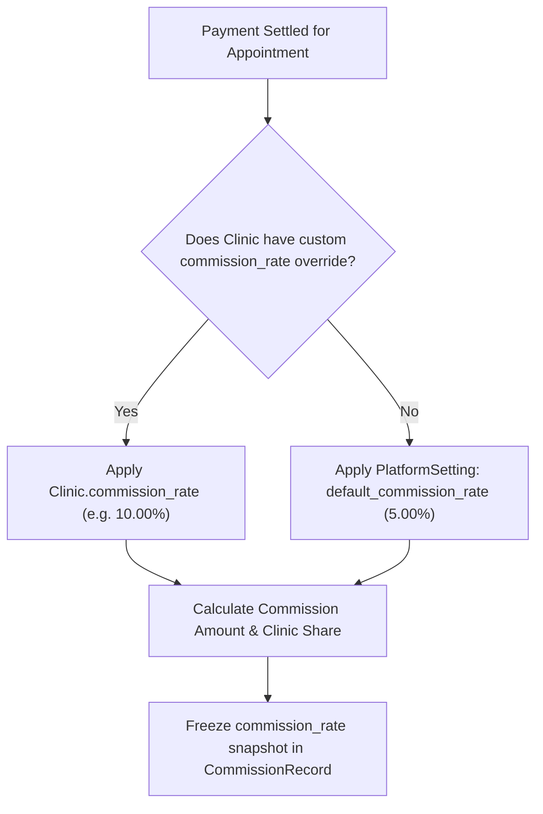

# EazyDoc SaaS Revenue Calculation & Accounting Invariant Rules

This document specifies the exact financial logic, mathematical definitions, rounding algorithms, and accounting invariants governing EazyDoc's multi-tenant Doctor Booking SaaS platform.

---

## 1. Fundamental Double-Entry Accounting Invariant

For every successful consultation transaction processed through EazyDoc, the gross collected payment must equal the sum of the retained platform commission and the calculated clinic share:

$$\text{gross\_amount} = \text{commission\_amount} + \text{clinic\_share}$$

### Invariant Verification Constraints
1. **Model Check Constraint**: Enforced at the PostgreSQL / SQLite database level via check constraints on `CommissionRecord`:
   - `gross_amount >= 0.00`
   - `commission_amount >= 0.00`
   - `clinic_share >= 0.00`
2. **Model Clean Validation**: Enforced in Python within `CommissionRecord.clean()`:
   ```python
   if (self.commission_amount + self.clinic_share) != self.gross_amount:
       raise ValidationError("Accounting invariant violation: gross_amount != commission_amount + clinic_share")
   ```
3. **Analytics Integrity Verification**: Every analytics endpoint runs an invariant validation check and flags `accounting_invariant_valid = false` if any rounding drift exceeding `0.05` INR is detected.

---

## 2. Commission Rate Determination Hierarchy

The platform commission percentage is derived using a strict precedence order at the time of appointment payment settlement:



1. **Clinic Specific Override**: If `Clinic.commission_rate` is defined and not `None` (e.g. `10.00%`), it takes precedence.
2. **Platform Default Setting**: If `Clinic.commission_rate` is `None`, the rate falls back to `PlatformSetting.get_default_commission_rate()` (default: `5.00%`).
3. **Rate Bounds**: Commission rates must be non-negative and bounded between `0.00%` and `100.00%`.

---

## 3. Mathematical Formulae & Decimal Precision

All monetary calculations use Python's `Decimal` module and PostgreSQL's `NUMERIC(10, 2)` column types. Floating point arithmetic (`float`) is strictly prohibited in monetary code paths.

### Calculation Formulas
$$\text{commission\_amount} = \text{ROUND\_HALF\_UP}\left(\text{gross\_amount} \times \frac{\text{commission\_rate}}{100},\ 2\right)$$

$$\text{clinic\_share} = \text{gross\_amount} - \text{commission\_amount}$$

Calculating `clinic_share` as `gross_amount - commission_amount` mathematically guarantees that:
$$\text{commission\_amount} + \text{clinic\_share} \equiv \text{gross\_amount}$$
eliminating single-paise rounding discrepancies!

---

## 4. Historical Snapshot Immutability Rule

> **CRITICAL ARCHITECTURAL GUARANTEE**  
> All financial calculations and reports **MUST** evaluate historical transactions against the immutable `commission_rate` and amounts frozen inside `CommissionRecord` at transaction creation time.

### Why Immutability is Enforced:
1. **Audit & Regulatory Compliance**: Altering platform settings or clinic agreements must never retroactively change past revenue distributions or tax liabilities.
2. **Deterministic Ledger**: Financial statements generated for a past month (e.g. October 2026) will produce identical numbers regardless of when the report is executed.
3. **Contractual Integrity**: Clinics agreed to commercial terms active at the moment of booking; retroactive changes would violate tenant trust and contract terms.

---

## 5. Multi-Clinic Doctor Commercial Terms

Doctors on EazyDoc can affiliate with multiple clinics simultaneously (e.g., Apollo Clinic and City Care Hospital).

### Isolation Rules:
- **No Global Fee**: There is no such concept as a "global doctor fee". Each affiliation has its own `DoctorClinic.consultation_fee`.
- **Clinic-Specific Split**: If Dr. Gregory House charges ₹1,000 at Clinic A (10% commission = ₹100 platform, ₹900 clinic) and ₹500 at Clinic B (5% commission = ₹25 platform, ₹475 clinic), the platform records each transaction under its respective clinic ledger.
- **Reporting Separation**: Clinic Owner dashboards only display the volume and revenue generated within *their* clinic facility.

---

## 6. Payable Liability vs. Bank Disbursement Distinction

EazyDoc clearly distinguishes between:
1. **Gross Revenue Collected**: Funds collected from patients via Razorpay checkout.
2. **Net Platform Commission**: Retained SaaS revenue earned by EazyDoc.
3. **Clinic Payable Share**: Internal ledger liability owed to the clinic.
4. **Disbursed Bank Payouts**: Physical transfer of funds to clinic bank accounts.

### Mandatory Transparency Disclaimer
Every clinic-facing and administrative financial screen displays the following notice:
> *"Calculated clinic shares represent internal ledger allocations. Actual clinic bank payouts are 0.00 until explicit payout gateway clearance."*
