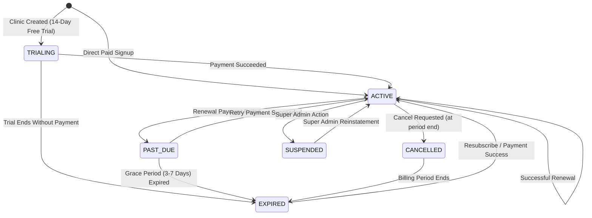
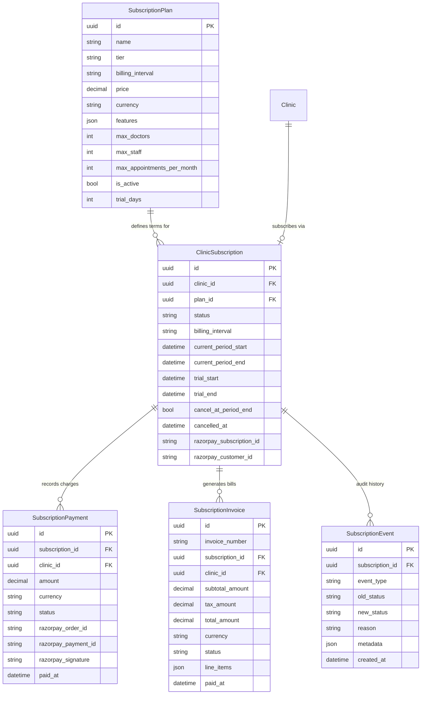

# SaaS Subscription & Billing Architecture

**Document Reference:** `docs/subscription-architecture.md`  
**Status:** Approved Architecture  
**Author:** Senior SaaS Architect & SRE Team  
**Scope:** Multi-Tenant Healthcare SaaS Clinic Subscriptions, Recurring Billing, Entitlement Enforcement & Invoicing

---

## 1. Executive Summary

EazyDoc is a multi-tenant Doctor Booking SaaS platform where healthcare clinics and hospitals operate independently. While patients pay for medical consultations via the appointment checkout engine (`apps.payments`), clinic facilities subscribe to the SaaS platform to access practice management tools, multi-doctor scheduling, staff access delegation, revenue analytics, and automated reminders.

This document details the architectural foundation for **Day 20 — Subscription Plans, SaaS Billing & Monetization**.

### Critical Architectural Principle: Strict Financial Separation
> [!IMPORTANT]
> **Subscription billing is completely separated from patient appointment payments.**
> - Patient consultation payments reside in `apps.payments.models.Payment` and are tied to `appointments.Appointment`.
> - Clinic SaaS subscription billing resides exclusively in `apps.subscriptions` models (`SubscriptionPlan`, `ClinicSubscription`, `SubscriptionPayment`, `SubscriptionInvoice`, `SubscriptionEvent`).
> - There is zero cross-contamination between patient payment flows and clinic SaaS billing ledgers.

---

## 2. Reusable Existing Infrastructure

The subscription system leverages established, production-grade foundational components:

| Component | Location / Module | Reused Functionality |
| :--- | :--- | :--- |
| **Clinic Multi-Tenancy** | `apps.clinics.models.Clinic` | Clinic entity boundary (`Clinic.id`). Subscriptions are assigned per-clinic, enabling multi-clinic owners to manage distinct tiers for each facility. |
| **Authentication & RBAC** | `apps.accounts.models.User` | JWT authentication, role verification (`CLINIC_OWNER`, `STAFF`, `SUPER_ADMIN`). |
| **Gateway Infrastructure** | `settings.RAZORPAY_KEY_ID`, `RAZORPAY_KEY_SECRET` | Common Razorpay credentials and HMAC-SHA256 signature verification utilities. |
| **Multi-Channel Notifications** | `apps.notifications.services.NotificationService` | In-app alerts and transactional email dispatches for trial expiry, payment success, and past-due notices. |
| **Distributed Task Queue** | Celery & Celery Beat (`config/celery.py`) | Automated daily scans for expiring trials, renewal triggers, and grace period expirations. |
| **Audit Logging** | `apps.audit_logs` | Security, subscription status transition, and administrative override logging. |

---

## 3. Subscription Business Model & Plans

Subscriptions are defined flexibly in the database via `SubscriptionPlan`. Plan pricing and quotas are **never hardcoded in code**.

### Initial Seed Plans

| Metric / Feature | Free Plan (`FREE`) | Starter Plan (`STARTER`) | Professional Plan (`PROFESSIONAL`) | Enterprise Plan (`ENTERPRISE`) |
| :--- | :--- | :--- | :--- | :--- |
| **Target Segment** | Solo practitioners / Trial users | Growing community clinics | Multi-specialty polyclinics | Large hospitals & chains |
| **Monthly Price** | ₹0 / mo | ₹1,499 / mo | ₹3,999 / mo | ₹9,999 / mo |
| **Yearly Price** | ₹0 / yr | ₹14,990 / yr (Save 17%) | ₹39,990 / yr (Save 17%) | ₹99,990 / yr (Save 17%) |
| **Doctor Limit (`max_doctors`)** | 1 | 3 | 10 | Unlimited (`null`) |
| **Staff Limit (`max_staff`)** | 1 | 3 | 10 | Unlimited (`null`) |
| **Appointments / Mo** | 50 | 300 | 1,500 | Unlimited (`null`) |
| **Advanced Analytics** | No (Basic overview only) | Yes (Revenue & Doctors) | Full (Ledger + Trends) | Full + Custom BI |
| **Report Exports (CSV/PDF)** | No | CSV Only | CSV & PDF | CSV & PDF + Audit |
| **Multi-Location Support** | 1 Clinic per Plan | 1 Clinic per Plan | 1 Clinic per Plan | Multi-branch discounts |
| **Support SLA** | Community | Standard Email (24h) | Priority Email/Chat (4h) | Dedicated Account Manager |

---

## 4. Multi-Tenant Clinic Subscription Ownership

In EazyDoc, a single `CLINIC_OWNER` user can own and administer multiple distinct clinics (`Clinic` entities).

```
User (Role: CLINIC_OWNER)
  │
  ├── Clinic A (Downtown Polyclinic)  ───► ClinicSubscription (Tier: PROFESSIONAL, Status: ACTIVE)
  │
  └── Clinic B (Suburban Health Post) ───► ClinicSubscription (Tier: STARTER, Status: ACTIVE)
```

1. **Independent Subscriptions**: Every clinic maintains its own active `ClinicSubscription`. Upgrading Clinic A has zero effect on Clinic B.
2. **Per-Clinic Billing**: Invoices and payments are tied to the specific `Clinic` and billing contact.
3. **Staff Inheritance**: Clinic staff members (`ClinicStaff`) bound to Clinic A are governed by Clinic A's subscription plan entitlements.

---

## 5. Subscription Lifecycle State Machine

A subscription adheres to a deterministic, secure state machine:



### State Definitions & Capabilities
- **`TRIALING`**: 14-day free trial on Professional or Starter features. Full feature access.
- **`ACTIVE`**: Fully paid subscription within valid `current_period_start` and `current_period_end`.
- **`PAST_DUE`**: Gateway renewal failed. Grace period (default 5 days) granted. Full access remains active, with prominent banner warnings.
- **`CANCELLED`**: The owner initiated cancellation. Marked `cancel_at_period_end = True`. Access continues until `current_period_end`.
- **`EXPIRED`**: Trial or subscription period ended without payment. Clinic reverts to read-only or restricted Free tier limits.
- **`SUSPENDED`**: Super Admin manually suspended the facility due to policy violation or investigation. All non-admin operations blocked.
- **`INCOMPLETE`**: Checkout initialized but gateway payment pending.

---

## 6. Centralized Entitlement Enforcement Strategy

### Non-Destructive Downgrade & Expiration Policy
> [!CAUTION]
> **Zero Data Destruction:** When a clinic downgrades, expires, or is suspended, the platform **NEVER** deletes existing doctors, staff accounts, past appointments, medical records, or consultation notes.

Instead, the system enforces **Creation and Association Boundaries**:
1. **Doctor Associations (`can_add_doctor`)**: If a clinic has 5 doctors and downgrades to Free (limit 1), existing doctors remain associated, but adding a new doctor or inviting a doctor is blocked with HTTP 403 (`PLAN_LIMIT_EXCEEDED`).
2. **Staff Accounts (`can_add_staff`)**: If staff limit is exceeded, existing staff retain access or are flagged, but inviting new staff is blocked.
3. **Feature Access (`has_feature(flag)`)**: Advanced features like financial export or deep analytics return 403 Forbidden or filtered payloads.

---

## 7. Database Entity Relationship Diagram



---

## 8. Payment Gateway Integration Architecture

1. **Order Creation (`POST /api/v1/clinics/{id}/subscription/checkout/`)**:
   - Clinic requests upgrade/renewal.
   - Backend calculates prorated amount (or full price for period).
   - Generates unique Razorpay Order with custom notes:
     `{"clinic_id": str(clinic.id), "plan_id": str(plan.id), "type": "SAAS_SUBSCRIPTION"}`.
   - Returns `order_id`, `amount`, `key_id`, `currency`, and clinic metadata to frontend checkout.
2. **Client Checkout & Signature Verification (`POST /api/v1/clinics/{id}/subscription/verify/`)**:
   - Razorpay Modal completes in browser and returns `razorpay_order_id`, `razorpay_payment_id`, `razorpay_signature`.
   - Backend computes HMAC-SHA256 signature using `settings.RAZORPAY_KEY_SECRET`.
   - On match: atomically creates `SubscriptionPayment`, updates `ClinicSubscription` to `ACTIVE`, creates immutable `SubscriptionInvoice`, records `SubscriptionEvent`, and dispatches notification.
3. **Webhook Redundancy (`POST /api/v1/webhooks/razorpay/subscriptions/`)**:
   - Ingests Razorpay webhook events (`payment.captured`, `payment.failed`, `subscription.charged`).
   - Validates webhook signature via `X-Razorpay-Signature`.
   - Idempotently verifies and catches payments if client browser disconnected before callback.

---

## 9. Security & Access Control

- **Tenant Isolation**: Only the verified `CLINIC_OWNER` of the clinic (or `SUPER_ADMIN`) can access or mutate that clinic's subscription and billing records.
- **Staff Restrictions**: Clinic `STAFF` members cannot view or manage subscription plans unless explicitly delegated with `MANAGE_CLINIC_PROFILE`.
- **Super Admin Governance**: Super Admins have dedicated endpoints to inspect all subscriptions, override statuses, comp accounts, and review platform-wide SaaS ARR/MRR.
