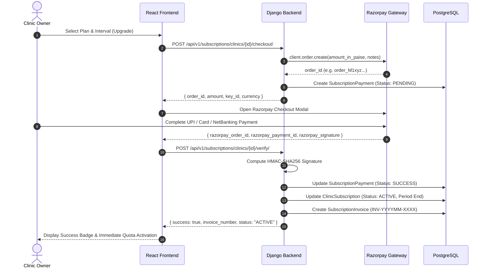

# SaaS Subscription Billing & Payment Gateway Integration

**Document Reference:** `docs/subscription-billing.md`  
**Status:** Active Production Specification  
**Author:** Payment Integration Specialist & SRE Architect  
**Scope:** Gateway Orchestration, Order Creation, Cryptographic Verification, Idempotency, and Separation of Concerns

---

## 1. Architectural Separation of Financial Workflows

A cornerstone architectural rule of EazyDoc is the **strict isolation** between:
1. **Patient Appointment Payments** (`apps.payments`): Patient consultation fees, commission splits, doctor settlements, and patient refunds.
2. **Clinic SaaS Subscription Billing** (`apps.subscriptions`): Software licensing charges paid by clinic owners to EazyDoc.

```
┌────────────────────────────────────────────────────────┐
│               EazyDoc Payment Gateway                  │
└──────────────────────────┬─────────────────────────────┘
                           │
         ┌─────────────────┴─────────────────┐
         ▼                                   ▼
┌─────────────────────────┐       ┌─────────────────────────┐
│ Patient Consultation    │       │ Clinic SaaS             │
│ Payments Engine         │       │ Subscriptions Engine    │
│ (apps.payments)         │       │ (apps.subscriptions)    │
├─────────────────────────┤       ├─────────────────────────┤
│ • Model: Payment        │       │ • Model: SubscriptionPayment
│ • Foreign: Appointment  │       │ • Foreign: ClinicSub    │
│ • Patient -> Clinic Fee │       │ • Clinic -> Platform Fee│
│ • Commission Ledger     │       │ • Tax Invoices (GST 18%)│
└─────────────────────────┘       └─────────────────────────┘
```

---

## 2. Subscription Checkout Workflow



---

## 3. Cryptographic Signature Verification

All client payment callbacks are cryptographically verified using HMAC-SHA256 before any subscription plan or quota mutation occurs.

```python
import hmac
import hashlib

def verify_payment_signature(order_id: str, payment_id: str, signature: str) -> bool:
    key_secret = settings.RAZORPAY_KEY_SECRET
    message = f"{order_id}|{payment_id}".encode("utf-8")
    expected_sig = hmac.new(
        key_secret.encode("utf-8"),
        message,
        hashlib.sha256,
    ).hexdigest()
    return hmac.compare_digest(expected_sig, signature)
```

- If signatures match: `SubscriptionPayment` updates to `SUCCESS`, subscription activates, and an invoice is generated.
- If verification fails: `SubscriptionPayment` is marked `FAILED` with error code `BAD_REQUEST_ERROR`, and the request is rejected with HTTP 400 Bad Request.

---

## 4. Idempotency & Duplicate Prevention

To prevent duplicate charges or repeated billing records:
1. **Idempotency Keys:** The frontend sends a unique UUID in `idempotency_key`. If an identical request arrives while an order is pending, the backend returns the existing pending order instead of generating a new gateway charge.
2. **Order & Payment Uniqueness:** `razorpay_order_id` and `razorpay_payment_id` are enforced with database-level `unique=True` constraints.
3. **Idempotent Verification:** If `verify_checkout_payment` is called multiple times for an already-verified order (e.g. user refreshed the page while gateway webhook also fired), the service returns the existing successful transaction and invoice without double-processing.
