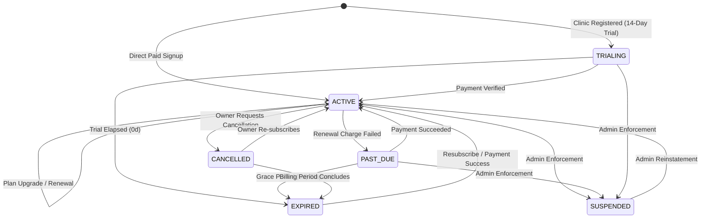

# SaaS Subscription Lifecycle & State Machine

**Document Reference:** `docs/subscription-lifecycle.md`  
**Status:** Active Production Specification  
**Author:** Senior SaaS Architect & SRE Team  
**Scope:** Finite State Machine, Transition Rules, Free Trial Automation, Grace Periods, and Audit Trails

---

## 1. Overview & State Machine Diagram

Every clinic facility in EazyDoc operates under a strictly audited finite state machine managed by `SubscriptionLifecycleService`.



---

## 2. Subscription Status Definitions & Capabilities

| Status | Meaning | Operational Access | Doctor/Staff Limits | Patient Bookings |
| :--- | :--- | :---: | :--- | :---: |
| **`TRIALING`** | 14-day initial evaluation period on Starter or Professional features. | ✅ Full Access | Plan Quotas Apply | Allowed |
| **`ACTIVE`** | Paid subscription with valid `current_period_end`. | ✅ Full Access | Plan Quotas Apply | Allowed |
| **`PAST_DUE`** | Renewal payment failed; 5-day grace period active. | ✅ Full Access (Warning Banner) | Plan Quotas Apply | Allowed |
| **`CANCELLED`** | Owner requested cancellation at period end (`cancel_at_period_end=True`). | ✅ Full Access Until Period End | Plan Quotas Apply | Allowed |
| **`EXPIRED`** | Trial ended or billing cycle elapsed without payment. | ⚠️ Restricted (Reverts to Free Tier) | Free Tier (1 Doc / 1 Staff) | Allowed (up to 50/mo) |
| **`SUSPENDED`** | Administratively locked by Super Admin for compliance review. | ❌ Blocked | All Mutating Actions Blocked | Blocked |
| **`INCOMPLETE`** | Gateway checkout order created, waiting for client capture. | ⚠️ Unchanged from previous | Unchanged | Unchanged |

---

## 3. Permitted Transition Matrix

The table below outlines permitted state transitions validated by `SubscriptionLifecycleService.can_transition()`:

| Current Status | Permitted Target Statuses | Trigger Mechanism |
| :--- | :--- | :--- |
| **`TRIALING`** | `ACTIVE`, `EXPIRED`, `SUSPENDED` | Gateway checkout payment, Celery trial expiry, or Admin suspension. |
| **`ACTIVE`** | `PAST_DUE`, `CANCELLED`, `EXPIRED`, `SUSPENDED`, `ACTIVE` (Renewal/Upgrade) | Payment failure, user cancellation, period expiry, or upgrade. |
| **`PAST_DUE`** | `ACTIVE`, `EXPIRED`, `SUSPENDED` | Successful retry payment, grace period expiry (5 days), or Admin lock. |
| **`CANCELLED`** | `EXPIRED`, `ACTIVE`, `SUSPENDED` | Period end elapsed, user reactivates, or Admin suspension. |
| **`EXPIRED`** | `ACTIVE`, `TRIALING` (Admin comp only), `SUSPENDED` | Plan checkout payment or Super Admin override. |
| **`SUSPENDED`** | `ACTIVE`, `EXPIRED`, `TRIALING` | Super Admin manual reinstatement. |
| **`INCOMPLETE`** | `ACTIVE`, `EXPIRED` | Payment verification callback or timeout. |

---

## 4. Free Trial Management & Abuse Prevention

1. **Automatic Initialization:** When a clinic is registered, `SubscriptionLifecycleService.initialize_clinic_subscription()` checks whether the clinic has previously consumed a trial (`has_used_trial = True`).
2. **Initial Plan:** New clinics receive a 14-day free trial on the **Starter Plan** or **Professional Suite**.
3. **Abuse Guard:** The `has_used_trial` flag is set to `True` upon trial start and is permanent across the lifetime of the clinic. If a clinic cancels and returns, it cannot start a new trial and must choose the Free tier or a paid plan.
4. **Warning Alerts:** At 3 days before trial expiration, Celery Beat dispatches `SUBSCRIPTION_TRIAL_EXPIRING` in-app and email notifications to the clinic owner.
5. **Non-Destructive Expiry:** When the 14-day trial concludes without payment, the subscription gracefully transitions to `ACTIVE` on the **Free Community Plan** (`tier = FREE`).

---

## 5. Cancellation & Grace Period Workflows

### Safe Cancellation (`request_cancellation`)
- When an owner clicks "Cancel Subscription", the platform prompts for an optional cancellation reason.
- The record is flagged with `cancel_at_period_end = True` and status set to `CANCELLED`.
- **Zero data is destroyed:** Doctors, schedules, appointments, and patient documents remain untouched.
- The clinic maintains full operational access until `current_period_end`.
- Once `current_period_end` passes, Celery automatically reverts the facility to the Free Community plan.

### Past-Due Grace Period (`mark_past_due`)
- If an automatic renewal fails, status changes to `PAST_DUE`.
- `grace_period_ends_at` is set to `timezone.now() + timedelta(days=5)`.
- During these 5 days, doctor appointments and clinic management continue operating normally with a prominent dashboard banner prompting the owner to update payment methods.
- If payment is not completed within 5 days, Celery executes `expire_subscription(fallback_to_free=True)`.

---

## 6. Audit Trail: `SubscriptionEvent`

Every status change, plan switch, payment event, cancellation, and admin override is appended to the immutable `SubscriptionEvent` ledger:

```python
SubscriptionEvent.objects.create(
    subscription=subscription,
    clinic=clinic,
    event_type=SubscriptionEventType.PLAN_UPGRADED,
    old_status=old_status,
    new_status=new_status,
    old_plan_name=old_plan.name,
    new_plan_name=new_plan.name,
    reason="Payment verified via Razorpay Checkout.",
    triggered_by=request.user,
    metadata={"amount": 3999.00, "currency": "INR"}
)
```

The audit history is accessible to Clinic Owners via `GET /api/v1/subscriptions/clinics/{id}/events/` and to Super Admins across all clinics via `GET /api/v1/admin/subscriptions/events/`.
