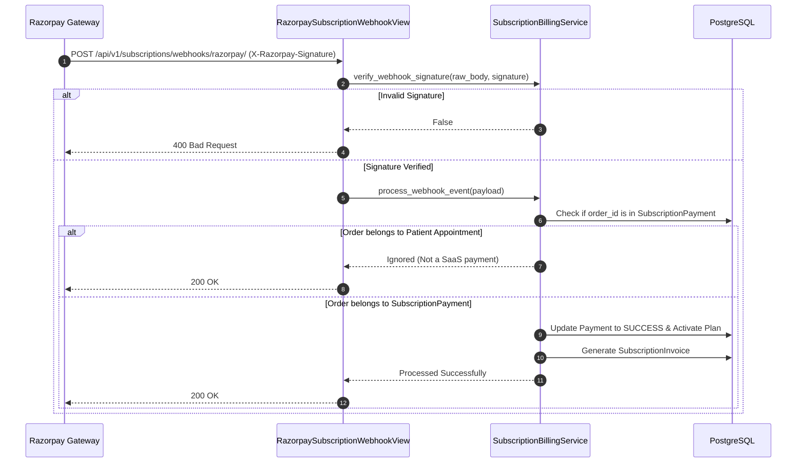

# Razorpay Subscription Webhooks & Event Reconciliation

**Document Reference:** `docs/subscription-payment-webhooks.md`  
**Status:** Active Production Specification  
**Author:** Payment Security Architect & Backend Lead  
**Scope:** Webhook Ingestion, Cryptographic Header Verification, Disambiguation, and Idempotent Event Handlers

---

## 1. Webhook Architecture & Ingestion Endpoint

Razorpay sends asynchronous server-to-server webhook notifications to guarantee payment state reconciliation even if a clinic owner closes their browser immediately after entering their UPI PIN.

- **Endpoint URL:** `POST /api/v1/subscriptions/webhooks/razorpay/`
- **CSRF Exemption:** Handled via `@method_decorator(csrf_exempt)` with HMAC-SHA256 signature verification.
- **Header:** `X-Razorpay-Signature`



---

## 2. Signature Verification Algorithm

Every webhook payload must be authenticated using the secret configured in `settings.RAZORPAY_WEBHOOK_SECRET`:

```python
def verify_webhook_signature(raw_body: bytes, signature_header: str) -> bool:
    secret = settings.RAZORPAY_WEBHOOK_SECRET
    if not secret:
        return True  # Fallback for local test environments
    expected = hmac.new(secret.encode("utf-8"), raw_body, hashlib.sha256).hexdigest()
    return hmac.compare_digest(expected, signature_header)
```

---

## 3. Supported Webhook Events & Actions

| Event Name | Event Meaning | System Action |
| :--- | :--- | :--- |
| `payment.captured` | Payment successfully captured by Razorpay. | Looks up `SubscriptionPayment` by `order_id`. If pending, marks `SUCCESS`, activates plan, generates invoice. |
| `order.paid` | Order fully settled. | Fallback for `payment.captured`. Idempotently confirms subscription activation. |
| `payment.failed` | Card declined or transaction error. | Marks `SubscriptionPayment` as `FAILED` with sanitized error codes. Leaves current subscription active for retries. |
| `subscription.charged`| Recurring charge billed automatically. | Extends subscription `current_period_end` by interval; generates renewal invoice. |

---

## 4. Disambiguation: SaaS vs Patient Appointment Payments

Because both patient consultation fees and clinic subscription payments route through Razorpay, the webhook handler must cleanly disambiguate events without cross-contaminating ledgers:

1. **Order Querying:** The handler checks if `order_id` exists in `SubscriptionPayment`:
   ```python
   payment = SubscriptionPayment.objects.filter(razorpay_order_id=order_id).first()
   if not payment:
       # Safe ignore: Event belongs to a patient consultation payment handled by apps.payments
       return True, "Ignored: Not a subscription payment"
   ```
2. **Metadata Tags:** All subscription orders embed `{"type": "SAAS_SUBSCRIPTION"}` in order notes for automated log audits.

---

## 5. Webhook Security Checklist

- [x] Raw request body (`request.body`) used for cryptographic hash calculation prior to JSON parsing.
- [x] Constant-time string comparison (`hmac.compare_digest`) prevents timing attacks.
- [x] Atomic transactions (`@transaction.atomic`) guarantee that payment status and subscription status update simultaneously.
- [x] Idempotency: Duplicate delivery of the same webhook returns HTTP 200 without creating duplicate invoices.
